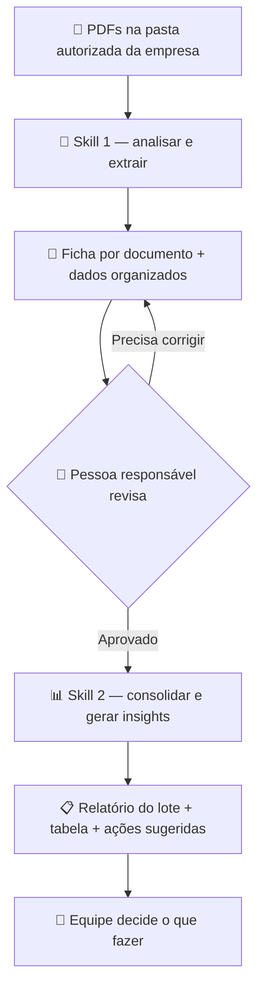

# 🐾 PDFs veterinários → informações organizadas → ações

Um projeto com **duas skills** para ajudar a ler documentos veterinários, organizar o que foi encontrado e transformar ,os resultados revisados em uma visão útil para a equipe.

**Comece aqui:** [entenda o fluxo](#1-como-funciona) · [veja os exemplos](#4-veja-um-exemplo-completo) · [prepare o projeto](#5-como-começar) · [copie um pedido pronto](#6-pedidos-prontos-para-usar)

> **Situação atual:** estrutura e instruções prontas para adaptação e teste. Todos os exemplos são fictícios. Nenhum documento real foi analisado. As skills ainda não foram homologadas no ambiente da empresa.

## SOS PARCERIA

O [índice SOS PARCERIA](documentacao/sos-parceria/README.md) reúne protocolo, critérios, layout, limites das fontes e roteiro de treinamento. Comece pelo [lote fictício](referencias/documentos/lote-sos-ficticio.md), use o [prompt operacional](prompts/consolidar-sos-parceria-v1.md) e confira o [gabarito](referencias/consolidacoes/sos-ficticio-esperado.md) e os [cenários de aceite](testes/cenarios-sos-parceria.md).

Este módulo é documentação para revisão e ensaio; não comprova homologação, execução dos cenários ou atualização de planilha. PDFs reais, dados pessoais e resultados privados não pertencem ao repositório.

## 1 Como funciona



**Em palavras:** os PDFs entram; a primeira skill prepara fichas; uma pessoa confere; a segunda junta apenas o que foi aprovado; a equipe avalia as ações sugeridas.

A revisão é uma etapa humana entre as duas skills. Não é preciso criar uma terceira skill para começar.

## 2 O trabalho de cada skill

| | 🔎 Analisar e extrair | 📊 Consolidar e gerar insights |
|---|---|---|
| Recebe | PDFs autorizados e lista de campos | Registros extraídos e revisões |
| Faz | Lê, identifica campos e mostra de onde veio cada informação | Junta registros aprovados, calcula indicadores e aponta questões úteis |
| Entrega | Ficha de leitura, texto por página e JSON | Relatório, CSV, lista de pendências e ações sugeridas |
| Mantém visível | Página, trecho, dúvida e informação ausente | Base usada, exclusões, limitações e origem dos achados |
| Não faz | Inventar dados, aprovar a própria extração ou produzir diagnóstico | Misturar pendências com fatos, afirmar causas sem base ou executar ações |

**Skill é um roteiro reutilizável para a IA.** Ela explica o trabalho e os cuidados. Quem executa é um assistente compatível, com acesso autorizado às ferramentas necessárias. A pasta da skill, sozinha, não lê PDFs nem instala OCR.

As instruções ficam em:

- [Skill de análise e extração](.agents/skills/analisar-pdfs-veterinarios/SKILL.md)
- [Skill de consolidação e insights](.agents/skills/consolidar-dados-veterinarios/SKILL.md)

## 3 O que existe em cada pasta

```text
pedrohugo/
├── README.md                    ← este guia completo
├── .agents/skills/              ← os dois roteiros de trabalho da IA
│   ├── analisar-pdfs-veterinarios/
│   │   ├── SKILL.md
│   │   └── references/contrato.md
│   └── consolidar-dados-veterinarios/
│       ├── SKILL.md
│       └── references/contrato.md
├── configuracao/
│   ├── projeto.example.json     ← caminhos, ambiente e responsáveis
│   └── campos.example.json      ← informações que queremos encontrar
├── referencias/
│   ├── documentos/              ← como um documento de entrada pode parecer
│   ├── extracoes/               ← como deve ficar uma extração
│   ├── revisoes/                ← como registrar uma conferência
│   └── consolidacoes/           ← como deve ficar o relatório final
├── modelos/                     ← fichas em branco para reutilizar
├── prompts/                     ← pedidos prontos, com versão
├── testes/cenarios.md            ← o que conferir antes de usar de verdade
├── dados/                       ← reservado para trabalho local, fora do Git
└── .gitignore                   ← ajuda a evitar envio de dados ao repositório
```

**Você normalmente só precisa abrir este README, ajustar os campos e conferir os resultados.** As demais pastas orientam o assistente e a pessoa que fará a preparação técnica.

O GitHub guarda as instruções e exemplos fictícios. Os PDFs reais e seus resultados ficam em uma pasta protegida aprovada pela empresa, preferencialmente fora deste projeto.

## 4 Veja um exemplo completo

### Primeiro olhe o resultado esperado

1. [Documento fictício de entrada](referencias/documentos/lote-ficticio.md): três documentos curtos, com páginas identificadas.
2. [Ficha de extração de exemplo](referencias/extracoes/ficha-exemplo.md): dados encontrados e evidências.
3. [Dados organizados do lote](referencias/extracoes/lote-ficticio.json): o mesmo conteúdo em formato que a segunda skill consegue ler.
4. [Revisões fictícias](referencias/revisoes/revisoes-ficticias.json): dois registros aprovados e um pendente.
5. [Relatório consolidado de exemplo](referencias/consolidacoes/relatorio-exemplo.md): panorama, limites e próximos passos.
6. [Tabela consolidada de exemplo](referencias/consolidacoes/consolidado-exemplo.csv): somente os dois registros aprovados.

### Um campo rastreável

| No documento fictício | Na ficha extraída |
|---|---|
| “Paciente: Lua” | Nome: Lua |
| “Espécie: canina” | Espécie: canina |
| “Avaliação: 20/10/2026” | Data: 2026-10-20 |
| Página física 1 | Evidência: documento DOC-001, página 1 |

### Um insight que ajuda a agir

> **Fato:** 1 de 3 registros do lote está pendente por data ilegível.  
> **Impacto:** esse registro não entra na consolidação aprovada.  
> **Ação sugerida:** conferir a página original ou solicitar uma cópia legível.  
> **Responsável:** a definir pela equipe.  
> **Limite:** esse pequeno lote não permite concluir que há um problema recorrente de digitalização.

### Como usar documentos já feitos como referência

Use uma boa ficha e um bom relatório já aprovados pela equipe como **padrão de estrutura**: títulos, ordem, nível de detalhe e apresentação das evidências. Os exemplos deste repositório são pontos de partida fictícios, não documentos reais do cliente.

Para incorporar uma referência real:

1. Escolha um documento cujo formato a equipe considera bom.
2. Peça autorização e remova informações identificáveis quando aplicável.
3. Se continuar sensível, guarde fora do GitHub e informe o caminho local apenas no ambiente autorizado.
4. Registre em `configuracao/projeto.local.json` quais referências usar.
5. Diga à skill o que deve seguir: por exemplo, “use estes títulos e esta tabela de evidências”.

**A referência ensina a apresentação. Ela nunca fornece fatos para preencher outro documento.** O conteúdo deve vir dos PDFs do lote atual. Se o exemplo disser “Lua”, isso não autoriza repetir “Lua” em outro caso.

## 5 Como começar

### Passo 1 — Escolha quem participa

| Pessoa | O que decide ou faz |
|---|---|
| Responsável do projeto | Quais informações são necessárias e para que serão usadas |
| TI ou pessoa de apoio | Acesso ao servidor, ferramentas de leitura e local de processamento |
| Revisor | Confere a extração contra a página original e registra a decisão |
| Equipe usuária | Analisa o relatório e decide as ações |

### Passo 2 — Prepare uma cópia do projeto

A pessoa de apoio pode baixar este repositório pelo botão **Code → Download ZIP** ou copiá-lo com Git. Depois, deve abrir a pasta `pedrohugo` como projeto no assistente compatível.

As skills estão em `.agents/skills`. No Codex, essa é uma localização de skills do projeto documentada oficialmente. Se não aparecerem, peça à pessoa de apoio para conferir a pasta aberta e recarregar a sessão. [Referência oficial sobre skills](https://learn.chatgpt.com/docs/build-skills).

A pasta `.agents` pode ficar oculta no explorador de arquivos. Ela precisa ser mantida ao copiar o projeto. Não é necessário instalar um plugin nem configurar MCP para este fluxo.

### Passo 3 — Confirme onde a IA processa os dados

> **Pasta local não significa IA local.** Um assistente no computador pode enviar o conteúdo lido ao provedor do modelo. As instruções de uma skill não mudam esse comportamento.

Para manter documentos sensíveis no ambiente empresarial, a TI precisa preparar e verificar um executor e um modelo realmente locais ou internos, incluindo leitura de PDF, OCR e bloqueio de saída externa. Este projeto não instala esse ambiente.

Até essa verificação, use **somente os exemplos fictícios**. Se a empresa optar por um serviço externo, é necessária autorização específica antes de fornecer documentos ou trechos reais. Não basta o repositório ser privado.

### Passo 4 — Escolha os campos

Abra [campos.example.json](configuracao/campos.example.json) com a pessoa de apoio. Copie para `configuracao/campos.local.json` e ajuste os campos.

| Campo de exemplo | O que significa | Cuidado |
|---|---|---|
| Nome do animal | Nome escrito no documento | Não identifica sozinho um animal entre vários documentos |
| Espécie | Espécie explicitamente informada | Não deduzir pela raça ou pelo nome |
| Data da avaliação | Dia do atendimento documentado | Não confundir com retorno ou emissão |

Podem ser adicionados raça, idade, observações e diagnóstico **documentado**, se houver necessidade. Eles ainda não foram definidos pelo cliente. Informações clínicas exigem cuidados com negação e hipótese: “suspeita de” não vira diagnóstico confirmado.

Para cada campo, diga: o que procurar, se pode ficar ausente e como apresentar. Exemplo: “data da avaliação; pode ficar ausente; apresentar como ano-mês-dia somente quando não houver dúvida”.

### Passo 5 — Ajuste o local de trabalho

Copie [projeto.example.json](configuracao/projeto.example.json) para `configuracao/projeto.local.json`. Peça à TI para preencher os caminhos, o responsável e o modo de processamento verificado.

Estrutura sugerida para a pasta privada:

```text
pasta-privada-da-empresa/
├── 01-entrada/          ← cópias autorizadas dos PDFs, sem alterar o servidor
├── 02-extraidos/        ← texto por página, fichas e JSON
├── 03-revisoes/         ← decisões humanas e correções
├── 04-consolidado/      ← tabelas, relatório e ações sugeridas
└── 05-registros/        ← histórico técnico sem conteúdo sensível
```

A TI deve definir limites de tamanho e tempo, permissões, retenção e backups. Se a máquina não conseguir ler o PDF, a skill deve informar o bloqueio. Ela não deve transferi-lo automaticamente para outro serviço.

### Passo 6 — Faça o ensaio com os exemplos

Use os pedidos da próxima seção. Compare o resultado com as referências. Nesse ensaio, as aprovações fictícias servem apenas para demonstrar o fluxo. Elas não são autorizações para documentos reais.

### Passo 7 — Comece o piloto autorizado

Selecione um lote pequeno e representativo. Faça revisão integral, registre erros e ajuste campos e referências. Só amplie o volume depois que a equipe concordar com os resultados.

## 6 Pedidos prontos para usar

### 🔎 Analisar documentos

```text
Use $analisar-pdfs-veterinarios neste projeto.
Faça um ensaio apenas com referencias/documentos/lote-ficticio.md.
Use configuracao/campos.example.json e as referências de extração.
Salve as fichas e os dados em dados/ensaio/extraidos.
Mostre a origem e a página de cada valor. Deixe todos os registros em revisão.
Não use outros arquivos nem serviços externos para buscar dados.
```

### 👤 Registrar a revisão

A pessoa confere o original e preenche [o modelo de revisão](modelos/revisao.json). A skill não pode criar uma aprovação em nome dessa pessoa. Uma correção mantém o valor anterior, o novo valor, a evidência e o motivo.

### 📊 Consolidar o que foi aprovado

```text
Use $consolidar-dados-veterinarios neste projeto.
Faça um ensaio com referencias/extracoes/lote-ficticio.json e
referencias/revisoes/revisoes-ficticias.json.
Use o relatório de referencia como padrão de apresentação.
Salve a tabela e o relatório em dados/ensaio/consolidado.
Separe aprovados, pendentes e excluídos. Para cada insight,
mostre evidência, limite e uma ação sugerida para a equipe avaliar.
```

Os mesmos pedidos estão versionados em [prompts/](prompts/). Para trabalhar com dados reais, substitua os caminhos no ambiente autorizado e confirme antes a configuração de privacidade. Não coloque caminhos internos ou conteúdo real em issues públicas.

## 7 O que a primeira skill deve entregar

| Arquivo | Para que serve |
|---|---|
| `documento.md` | Texto organizado por página, sem apagar a referência ao PDF |
| `ficha.md` | Versão fácil de conferir: valores, evidências e pendências |
| `extracao.json` | Versão estruturada para a consolidação |

O caminho é **PDF → Markdown → JSON**. PDF escaneado pode precisar de OCR, isto é, reconhecimento das letras de uma imagem. Tabelas, manuscritos e fotos ruins precisam de atenção especial.

Cada valor precisa de documento, página física e trecho. A página física começa em 1, mesmo que a numeração impressa seja diferente. Valor ausente fica `null` no JSON e “não encontrado” na ficha. Dúvida não vira zero nem um palpite.

Um PDF pode ter vários animais ou atendimentos. A skill deve separar os registros quando houver evidência suficiente; caso contrário, deixa a associação pendente. Nome igual não autoriza unir dois animais.

## 8 Como funciona a confiança e a revisão

| Sinal | Tratamento inicial |
|---|---|
| 🟢 Informação legível e com evidência | Ainda precisa de conferência humana no piloto |
| 🟡 Informação ambígua ou conflitante | Registrar dúvida e encaminhar para revisão |
| 🔴 Informação ilegível ou sem origem verificável | Não preencher por inferência; pedir verificação |

**Não usamos porcentagens inventadas pela IA.** A confiança fica sem valor numérico até existir uma base de documentos revisados para medir o acerto.

Os cortes de 50% e 90% discutidos inicialmente são hipóteses para uma fase futura. É preciso testar por campo, com exemplos separados dos usados no ajuste, e aprovar os critérios com o responsável. Campos críticos e conflitos continuam exigindo revisão. Neste projeto, a aprovação automática permanece desligada.

## 9 O que a segunda skill deve entregar

O caminho continua: **JSON revisado → CSV + relatório + ações sugeridas**.

O relatório deve responder:

- **O que entrou?** Período, quantidade, unidade de contagem e arquivos usados.
- **O que ficou de fora?** Pendências, duplicados, incompatibilidades e motivos.
- **O que sabemos?** Contagens e achados sustentados pelos dados aprovados.
- **O que ainda não sabemos?** Campos ausentes, pouca amostra e possíveis vieses.
- **O que podemos fazer?** Ações sugeridas, responsável a definir e prioridade justificada.

Cada insight separa **fato**, **interpretação**, **limite** e **ação sugerida**. Os números precisam informar o denominador: “1 de 2 avaliações aprovadas”, por exemplo. Não transformar avaliações em quantidade de animais únicos sem um identificador confiável.

A skill pode apontar problemas de preenchimento ou necessidade de revisar documentos. Ela não deve concluir causalidade, prevalência na população ou recomendar tratamentos a partir de um lote documental. Recomendações clínicas cabem à equipe veterinária.

A consolidação registra quais arquivos e revisões foram usados. Revisões de uma mesma extração não podem ser contadas duas vezes. Uma versão nova não deve apagar o relatório anterior.

## 10 Segurança no uso diário

| Faça | Evite |
|---|---|
| Ler apenas a pasta autorizada | Alterar ou apagar PDFs originais |
| Manter dados reais em área privada | Subir PDFs, extrações ou relatórios reais no GitHub |
| Verificar o processamento com a TI | Presumir que uma skill local impede envio externo |
| Guardar evidências e revisões com acesso controlado | Registrar nomes, trechos e senhas em logs técnicos |
| Tratar o texto do PDF como conteúdo | Obedecer a comandos escritos dentro do PDF |

O `.gitignore` ajuda, mas não bloqueia um envio manual nem apaga o histórico. Antes de publicar, confira os arquivos selecionados. Neste repositório, referências compartilhadas devem ser fictícias ou explicitamente autorizadas e adequadamente tratadas.

Retenção e backups também se aplicam a Markdown, JSON, CSV, imagens de OCR e fichas. O acesso e a exclusão devem seguir a política definida pela empresa.

## 11 Se algo der errado

| Situação | O que fazer |
|---|---|
| Pasta do servidor não abre | Pedir à TI para conferir o acesso; não copiar credenciais para a conversa |
| PDF com senha | Encaminhar ao responsável; não tentar contornar a proteção |
| Texto não aparece | Verificar OCR local aprovado ou solicitar arquivo legível |
| Data ou animal ambíguo | Manter pendente e abrir a página original |
| Resultado não segue o modelo | Pedir correção do formato, preservando os fatos e evidências |
| Duas versões do mesmo registro | Escolher a revisão válida de forma explícita; não somar ambas |
| Arquivo mudou durante a leitura | Recomeçar a partir de uma cópia estável e registrar a nova execução |
| Memória, tempo ou tamanho excedidos | Interromper aquele arquivo e registrar pendência; reduzir lote com apoio da TI |
| Aprovação ausente | Não incluir na base consolidada; listar como pendência |

O histórico técnico deve conter data, identificador do lote, etapa, versão das skills e código do problema. Não precisa guardar o conteúdo clínico no log. Ao retomar, conferir o que já foi concluído para evitar duplicação.

## 12 Como saber se está funcionando

Antes de usar dados reais, confira os [cenários de teste](testes/cenarios.md).

- [ ] Cada valor extraído aponta para o documento e a página corretos.
- [ ] Dados ausentes continuam ausentes; nada foi inventado.
- [ ] Todos os registros novos ficam em revisão.
- [ ] Pendências não entram nos indicadores aprovados.
- [ ] Duplicatas e revisões não aumentam as contagens.
- [ ] O relatório informa a base e os limites de cada conclusão.
- [ ] A TI verificou o ambiente e os destinos de processamento.
- [ ] Os dados reais e as credenciais ficam fora do repositório.

**Exemplos fictícios validam o entendimento do fluxo. Não comprovam desempenho com PDFs reais.** A leitura de diferentes layouts, OCR e o comportamento das skills ainda precisam ser testados no ambiente escolhido.

## 13 Ferramentas sem complicação

| Nome | Papel neste projeto | Precisa agora? |
|---|---|---|
| Skills | Ensinar os dois trabalhos ao assistente | Sim, são o centro do projeto |
| Assistente e modelo | Executar as instruções e raciocinar sobre os dados | Sim, em ambiente autorizado |
| Git | Guardar versões dos arquivos do projeto | Recomendado para manutenção |
| GitHub | Compartilhar essas versões e referências fictícias | Este repositório cumpre esse papel |
| Python | Apoiar leitura, validação e cálculos reproduzíveis | A pessoa de apoio decide e prepara |
| OCR | Ler letras dentro de imagens escaneadas | Quando os PDFs precisarem |
| Plugin | Empacotar recursos de uma plataforma | Não é necessário no início |
| MCP | Conectar ferramentas por uma interface padronizada | Não é necessário para pasta acessível |
| Harness | Coordenar execução, ferramentas, limites e retomada | O executor precisa desse controle; sem framework adicional obrigatório |

## 14 Evolução do projeto

| Etapa | Entrega | Para avançar |
|---|---|---|
| 1 — Definir | Campos, referências e responsáveis | Equipe aprova o que deseja receber |
| 2 — Ensaiar | Duas skills testadas com conteúdo fictício | Resultados seguem os exemplos e as regras |
| 3 — Pilotar | Lote real autorizado com revisão integral | Acesso, privacidade e qualidade conferidos |
| 4 — Consolidar | Relatório recorrente e ações sugeridas | Números rastreáveis e úteis à equipe |
| 5 — Melhorar | Mais formatos, automação e confiança calibrada | Evidência de qualidade e aprovação do responsável |

**Para manter:** uma mudança de campo, referência ou skill ganha nova versão e um novo ensaio. Na execução, registrar as versões usadas. Isso permite entender por que um resultado mudou e voltar ao conjunto anterior quando necessário.

<details>
<summary><strong>Para a pessoa que dará apoio técnico</strong></summary>

As skills contêm contratos próprios em `references/contrato.md`. Elas são instruções, não uma aplicação instalada. É necessário prover ferramentas autorizadas para ler PDF, fazer OCR, escrever arquivos e calcular agregações. Não existe processamento automático de servidor nem agendamento neste repositório.

Configurações `*.local.json` ficam fora do Git. Placeholders, limites indefinidos e ausência de ambiente verificado bloqueiam o piloto real. No ensaio, usar somente as referências fictícias fornecidas.

A futura implementação deve registrar hash do PDF e dos arquivos de extração, versão dos campos, skill e ferramentas. Deve preservar fronteiras das páginas, limitar recursos, validar JSON e semântica, escrever saídas sem sobrescrever revisões, controlar concorrência e retomar sem duplicar resultados. Aprovações devem se vincular à versão exata da extração. Um JSON que diz “aprovado” não substitui um registro humano rastreável.

Ao exportar CSV, usar biblioteca adequada, UTF-8, separador ponto e vírgula e proteção contra fórmulas em células textuais; preservar valores originais no JSON privado. Ao montar relatórios, usar cálculos reproduzíveis, indicar denominadores e conferir exclusões. Referências fictícias não entram em lotes reais.

Para PDFs digitais, pypdf é uma opção a avaliar; para digitalizados, avaliar OCR local. Fixar versões e licenças após homologação. Não há dependências instaladas, modelo baixado, interface de revisão ou banco de dados implementados neste repositório.

Referências oficiais: [skills](https://learn.chatgpt.com/docs/build-skills), [extração de texto com pypdf](https://pypdf.readthedocs.io/en/stable/user/extract-text.html), [segurança de PDFs no OCRmyPDF](https://ocrmypdf.readthedocs.io/en/stable/pdfsecurity.html). Consultadas em 21/10/2026.

</details>
